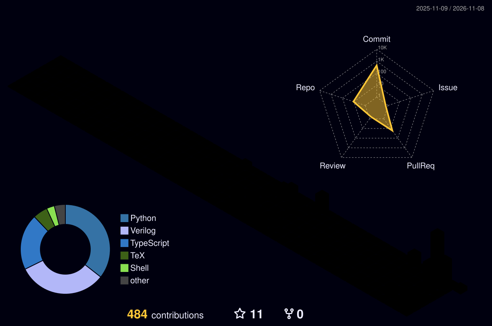

  

  B.Tech Computer Science &amp; Engineering @ <b>IMS Engineering College (AKTU)</b> · BS Computer Science @ <b>University of the People</b> 
  I build programming languages, CPUs, and operating systems from scratch — and small language models on top of them. 
  Right now: shipping <b>The Jal Pari Language</b> (v1.5.1, on PyPI) and training a TinyStories GPT to beat GPT-2.

  
  
  
  
  
  
  

---

### Projects

| Project | What it is |
|---|---|
| [The Jal Pari Language](https://github.com/themythofsisyphusjayant/RED-MOON-) | A safe, simple, natively fast language built from scratch — v1.5.1, [on PyPI](https://pypi.org/project/jalpari/) (`pip install jalpari`), native/WASM/big32 backends, freestanding mode |
| [Black Moon OS](https://github.com/themythofsisyphusjayant/BLACK-MOON-OS-) | Arch-based Linux distro with a macOS-style look, plus JalOS, a teaching OS in Jal Pari — bootable ISO built Oct 2026 |
| [big32](https://github.com/themythofsisyphusjayant/BIG-32) | A 32-bit RISC-V CPU built from zero in Verilog, booting a Linux kernel into early driver init |
| [OpenMythos](https://github.com/themythofsisyphusjayant/onion-ai) | A miniature recurrent language model, built from scratch — 44M trained on TinyStories, 1B roadmap underway |
| [Nyx](https://github.com/themythofsisyphusjayant/nyx-crystal-ai) | A decision-intelligence simulator with a live demo |
| [Provenance-Aware Belief Aggregation](https://github.com/themythofsisyphusjayant/PROVENANCE-AWARE-BELIEF-AGGREGATION) | A 17-page research manuscript on multi-agent communication |
| [ASIC Puzzle 2026](https://github.com/themythofsisyphusjayant/JANE-) | A chip reverse-engineered from its GDS layout alone |
| [Recurrent Small LMs](https://github.com/themythofsisyphusjayant/RECURRENT-SMALL-LMS) | NeurIPS-style technical report (22 pages) on recurrent small language models |
| [NYX Phoenix Migration](https://github.com/themythofsisyphusjayant/harshswarm-) | Enterprise multi-agent simulation platform — NYX migrated from Streamlit to Next.js + FastAPI, same deterministic kernel, zero logic loss |
| [TINY8](https://github.com/themythofsisyphusjayant/TINY8) | An 8-bit CPU built from zero in Verilog — sum 1..10 = 55, verified two ways |

---

### Featured work

**[The Jal Pari Language](https://github.com/themythofsisyphusjayant/RED-MOON-)** — a programming language built from scratch: static types, no null, immutable by default, checked arithmetic, native/WASM/RISC-V backends, and a freestanding mode on the road to a from-scratch OS. v1.5.1, [on PyPI](https://pypi.org/project/jalpari/).

**[Provenance-Aware Belief Aggregation](https://github.com/themythofsisyphusjayant/PROVENANCE-AWARE-BELIEF-AGGREGATION)** — when agents report through different communication conventions, weighting messages by source reliability answers the wrong question. This work proves structural limits of scalar trust weighting and introduces a Bayesian aggregator that decodes messages through inferred latent conventions. 17-page manuscript, headline runs over 190 seeds. [Beginner explainer](https://github.com/themythofsisyphusjayant/PROVENANCE-AWARE-BELIEF-AGGREGATION/blob/main/EXPLAINED_FOR_BEGINNERS.md)

**[OpenMythos](https://github.com/themythofsisyphusjayant/onion-ai)** — a from-scratch recurrent language model: does weight-shared recurrent iteration buy effective depth more cheaply than wider layers? 44M on TinyStories (one T4): loop depth 4 loss 1.484 vs depth-1 baseline 3.380 — but depth 8 is worse, so extrapolation is scale- and task-dependent. 1B config (1.06B params) ready. [44M report](https://github.com/themythofsisyphusjayant/onion-ai/blob/main/research/44m_experiment_report.md)

**[Nyx — Decision Intelligence Simulator](https://github.com/themythofsisyphusjayant/nyx-crystal-ai)** — give it a hard decision and a miniature society of AI agents debates it, with a deterministic kernel (same seed, same outcome) and a strategic forecast of risks and influencers. [Live demo](https://nyx-crystal-ai.lovable.app/)

**[Jane Street ASIC Puzzle 2026 — solved](https://github.com/themythofsisyphusjayant/JANE-)** — reverse-engineered a chip from its GDS layout alone, by four independent methods that all agreed. Serial-key lock, 121-bit key, flag `(* TWO STARS *)`. Published after submissions closed; nothing was submitted.

---

### Explained for beginners

Plain-language explainers, one analogy per project, with verified vs reported vs plan-only labels:
[PVI](https://github.com/themythofsisyphusjayant/PROVENANCE-AWARE-BELIEF-AGGREGATION/blob/main/EXPLAINED_FOR_BEGINNERS.md) · [Nyx](https://github.com/themythofsisyphusjayant/nyx-crystal-ai/blob/main/docs/EXPLAINED_FOR_BEGINNERS.md) · [OpenMythos 44M](https://github.com/themythofsisyphusjayant/onion-ai/blob/main/research/44m-explained-for-beginners.md) · [MiniMythos 125M](https://github.com/themythofsisyphusjayant/onion-ai/blob/main/research/minimythos-125m-explained-for-beginners.md) · [1B roadmap](https://github.com/themythofsisyphusjayant/onion-ai/blob/main/research/1b-roadmap-explained-for-beginners.md) · [ASIC puzzle](https://github.com/themythofsisyphusjayant/JANE-/blob/main/EXPLAINED_FOR_BEGINNERS.md)

---

### Education

- **BS in Computer Science** — University of the People (enrolled Oct 2026)
- **B.Tech in Computer Science &amp; Engineering** — IMS Engineering College (AKTU), 2026–2030

---

### My contributions, in 3D

  

  

---

### What I work with

`Python` · `PyTorch` · `C` · `Verilog` · `NumPy` · `LaTeX` · `Git` · `RISC-V`

**Interests:** programming languages · compilers · operating systems · small language models · multi-agent systems · Bayesian inference · hardware

---

  📫 Reach me: <a href="mailto:dubeymaya787@gmail.com">dubeymaya787@gmail.com</a>

