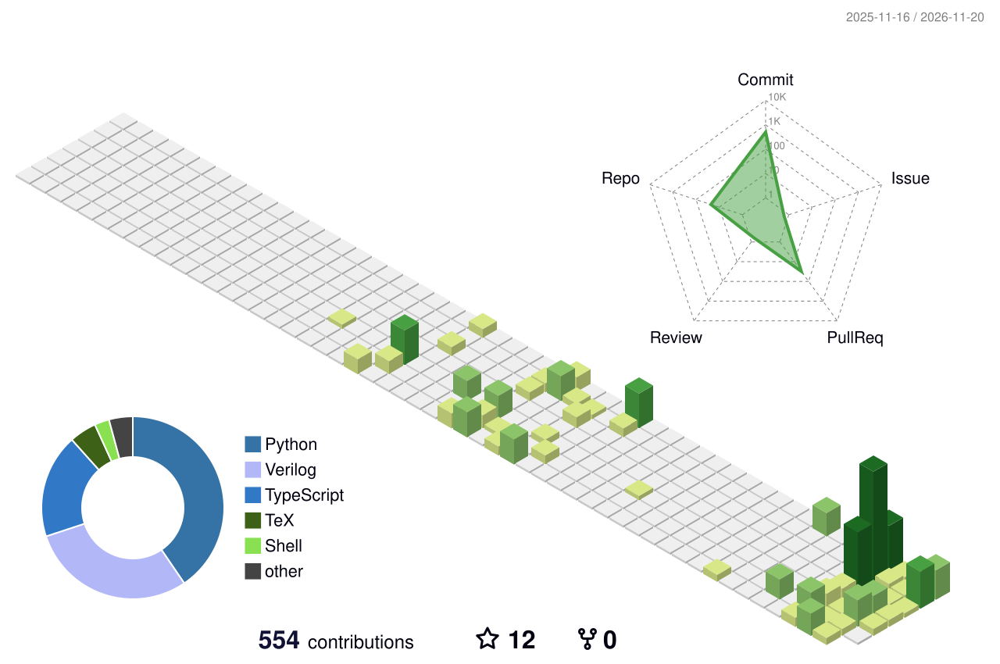
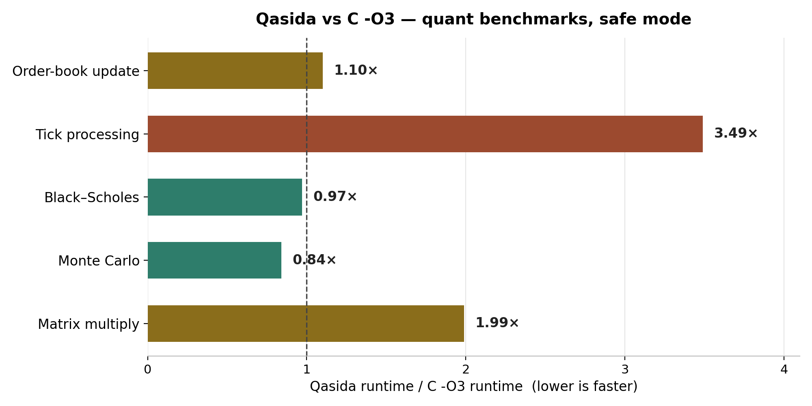
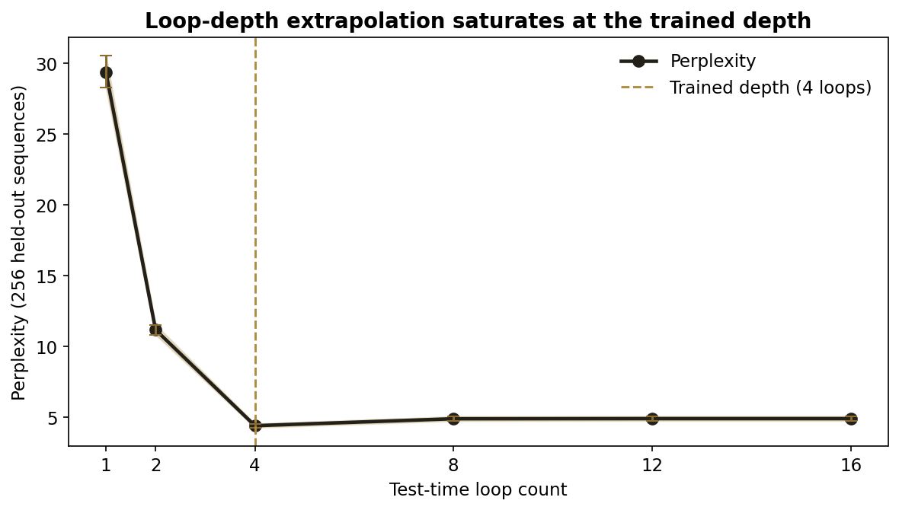

I work on multi-agent systems, Bayesian inference, small language models, and hardware built from zero. The through-line is measurement — claims in my projects are backed by runs, with the negative results reported alongside the positive ones.

      

---

## NOW

- **Qasida libs-only sprint week** (21–27 Nov) — standard library only, OS track paused. Top-500 catalogue: **HAVE 393 / 500 (78.6%)** as of 25 Nov.
- **Fix 1, Fix 2 and Fix 3 landed (21 Nov)** — safe mode now ties or beats C on every quant benchmark (see Results).
- **big32 Step 34** — the boot probe ran to its 500M-cycle cap on 23 Nov: healthy, no panic, no shell prompt yet; the stall question is still open.
- **First merged open-source contribution** — scikit-learn #35423, merged 23 Nov (see Open Source).

---

## EDUCATION

19 · First-year B.Tech, Computer Science & Engineering · BS Computer Science, University of the People

---

## RESEARCH INTERESTS

- **Multi-agent systems** — agents that communicate through different conventions disagree in ways scalar trust scores cannot fix; the interesting question is how beliefs should be decoded, not how much to weight them.
- **Bayesian inference** — principled reasoning under uncertainty, applied to aggregating evidence from heterogeneous, unreliable sources.
- **Language models** — small recurrent models built and trained from scratch, with the emphasis on what actually improves them: test-time compute, loop depth, and honest negative results.
- **Hardware from zero** — a CPU, its firmware, and its operating system built by hand, because owning the whole stack removes hidden assumptions about what the machine underneath is doing.

---

## FEATURED WORK

| PROJECT | WHAT IT IS | STATUS / RESULT |
|---|---|---|
| **[Qasida](https://github.com/themythofsisyphusjayant/RED-MOON-)** | A programming language built from scratch: static types, no null, immutable by default, checked arithmetic | v2.3.0 (16 Nov 2026), [on PyPI](https://pypi.org/project/qasida/) (`pip install qasida`). The compiler is self-hosting — it compiles itself — and has been the default since 11 Nov 2026. Native, WASM, and RISC-V backends; 30 registry packages; Top-500 catalogue HAVE 393/500 (78.6%, 25 Nov 2026). |
| **[big32](https://github.com/themythofsisyphusjayant/BIG-32)** | A 32-bit RISC-V CPU built from zero in Verilog: pipelined RV32IMA core, SBI firmware, device tree, CLINT, PLIC, virtio block | Linux 6.6.52 boots in simulation into early driver initialisation; the Step 34 probe ran to its 500M-cycle cap on 23 Nov 2026 — healthy, no panic, no shell prompt yet. Full boot to shell is work in progress. |
| **[MOON-OS](https://github.com/themythofsisyphusjayant/MOON-OS)** | An operating system written entirely in Qasida, targeting big32, with no Linux anywhere | Kernel, scheduler, filesystem, shell, and GUI in progress; freestanding kernels run on big32. Unified kernel integrating all subsystems on one memory map. |
| **[OpenMythos](https://github.com/themythofsisyphusjayant/OPENMYTHOS-RLM)** | A miniature recurrent language model built from scratch and trained on a single T4 | The 44M model trained on TinyStories; a 1.06B configuration is written, not yet trained. Key result: the 44M run is a reported negative result — extra loop depth at evaluation does not improve TinyStories loss (see below). |
| **[Nyx](https://github.com/themythofsisyphusjayant/NYX-CRYSTAL-AI)** | A deterministic decision-intelligence simulator: a miniature society of agents debates a hard decision and produces a strategic forecast of risks and fragile assumptions | Same seed, same outcome. [Live demo](https://nyx-crystal-ai.lovable.app/) |
| **[Black Moon OS](https://github.com/themythofsisyphusjayant/BLACK-MOON-OS-)** | An Arch-based Linux distribution with a macOS-style desktop, shipping JalOS, a teaching operating system written in Qasida | Bootable ISO built October 2026. |

---

## OPEN SOURCE

First merged contribution: **[scikit-learn #35423](https://github.com/scikit-learn/scikit-learn/pull/35423)** — merged 23 Nov 2026. Eleven pull requests open across CPython (#162076–#162078), pytest (#15401), pandas (#72161, #72162), gensim (#3682), catboost (#3260, #3261) and seaborn (#4038, #4039).

---

## RESULTS

### QASIDA VS C — QUANT BENCHMARKS

Safe mode vs C, after Fix 1 and Fix 2 (21 Nov 2026). Ratio below 1 means Qasida is faster. Fix 1 closed the tick gap (a single checked add in the hot loop); Fix 2 closed matrix multiply (vectorised safe emit).

| Benchmark | Qasida / C |
|---|---:|
| Matrix multiply | 0.44× |
| Monte Carlo | 0.75× |
| Black–Scholes | 0.92× |
| Black–Scholes (call) | 0.94× |
| Tick processing | 0.99× |
| Order-book update | 1.06× |

*Qasida safe-mode runtime relative to C, after Fix 1 and Fix 2 (21 Nov 2026). The dashed line marks parity with C (1.00×); bars to its left run faster than C.*

### RECURRENT SMALL LANGUAGE MODELS — LOOP-DEPTH SWEEP

Perplexity vs number of loops at test time (trained depth: 4). Extra loops past the trained depth buy nothing.

| Loops | 1 | 2 | 4 (trained) | 8 | 12 | 16 |
|---|---|---|---|---|---|---|
| Perplexity | 29.38 | 11.18 | 4.41 | 4.90 | 4.91 | 4.91 |

*Perplexity vs test-time loop count (trained depth: 4 loops), from the [Recurrent Small Language Models](https://github.com/themythofsisyphusjayant/RECURRENT-SMALL-LMS) technical report. Extra loops past the trained depth buy nothing.*

### OPENMYTHOS 44M — A NEGATIVE RESULT, REPORTED

The 44M Stage-0 run on TinyStories does **not** show extrapolation gains: evaluation at loop depth 8 is significantly worse than at the trained depth. The extrapolation story now rests on the 1B loop-curriculum run, not on this result.

---

## MANUSCRIPTS

These are manuscripts hosted on GitHub, not peer-reviewed publications.

- **[Provenance-Aware Belief Aggregation in Multi-Agent Communication Under Convention Heterogeneity](https://github.com/themythofsisyphusjayant/PROVENANCE-AWARE-BELIEF-AGGREGATION)** — a 17-page manuscript. When agents report through different communication conventions, weighting messages by source reliability answers the wrong question. This work proves structural limits of scalar trust weighting and introduces a Bayesian aggregator that decodes messages through inferred latent conventions. Headline runs over 190 seeds, fully reproducible.
- **[Recurrent Small Language Models](https://github.com/themythofsisyphusjayant/RECURRENT-SMALL-LMS)** — a 22-page technical report. It measures whether recurrent transformers gain anything from running extra loops at test time: perplexity falls from 29.4 to 4.4 as loops go from 1 to 4, then flatlines — extra loops buy nothing. Results carry 95% bootstrap confidence intervals.

---

## SKILLS

| AREA | |
|---|---|
| **Languages** | Qasida · Python · C · Verilog |
| **Systems** | RISC-V CPU design · Linux kernel boot · OS development (kernel, scheduler, filesystem, shell) |
| **Machine learning** | PyTorch · training small language models · Bayesian inference · multi-agent systems |
| **Tools** | Git · NumPy · LaTeX · Kaggle |

---

Contact: [dubeymaya153@gmail.com](mailto:dubeymaya153@gmail.com) · [Kaggle](https://www.kaggle.com/arshhdubeyy) · [Instagram](https://www.instagram.com/harshhd.wivedii/) · [LinkedIn](https://www.linkedin.com/in/jayant-dubey-a8a438289/)

